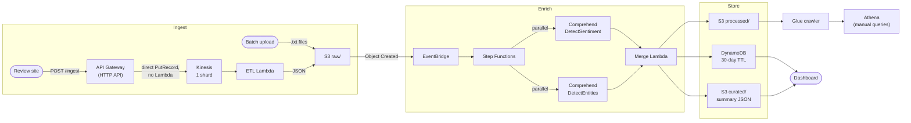

# AI-DP: Serverless Review Sentiment Pipeline

A serverless AWS pipeline, built with Terraform, that takes text from two sources (an HTTP API and S3 file uploads), scores sentiment and named entities with Amazon Comprehend, and stores the results for a live dashboard and SQL queries.

**The problem it models:** a company collects product reviews in two ways. Customers post reviews on its site as they happen, and someone on the team gathers reviews from elsewhere online and uploads them in batches. Both should end up in one place, scored the same way.

- **Cost:** $11.16 in August 2026, from AWS Cost Explorer
- **Tests:** 43 unit tests; CI fails below 90% coverage
- **Load test:** 1,000 events through the streaming path, with 0 Lambda errors and no Kinesis backlog
- **Delivery:** every PR is validated in CI, and merges to `main` deploy through GitHub OIDC with no stored AWS keys

**Status:** this runs in my own AWS account and won't stay deployed, so there's no public demo. To run your own copy, see [`docs/deploy.md`](docs/deploy.md).

## Architecture

Streaming reviews and batch uploads meet at S3 `raw/`: the ETL Lambda validates each Kinesis event and writes it as JSON, while batch files land directly as plain text. An EventBridge rule then starts one Step Functions execution per file. The merge Lambda writes each result to `processed/` for Athena, DynamoDB for the dashboard's recent-events table, and a running summary in `curated/` for its totals and chart.

## Tech stack

| Piece | Why I chose it |
|---|---|
| **Terraform** (S3 backend, native lockfile) | Everything is defined in code across 9 modules. State lives in S3 with `use_lockfile`, so no DynamoDB lock table. |
| **API Gateway HTTP API** | It can write to Kinesis with no code through the `Kinesis-PutRecord` integration. |
| **Kinesis Data Streams** | Buffers bursts in front of the Lambda. I'd never used it and wanted the experience. At this volume, SQS would have been enough. |
| **Step Functions** | Orchestrates the parallel Comprehend calls (see the first design decision). |
| **Amazon Comprehend** | Managed sentiment and entity detection, with no model to train or host. |
| **DynamoDB** | Small, short-lived (30-day TTL) data the dashboard can query newest-first through a GSI. |
| **S3 data lake** | `raw/` → `processed/` → `curated/` layers, each with its own lifecycle rules (IA, then Glacier, then expiry). |
| **Glue + Athena** | SQL over `processed/` for historical questions. Queried by hand; the dashboard doesn't call it. |
| **CloudWatch, X-Ray, SNS** | 5 alarms emailed through SNS, an 8-widget dashboard, and active tracing on both Lambdas. |
| **GitHub Actions + OIDC** | CI and deploy without stored AWS keys. |

## Design decisions and tradeoffs

- **Step Functions instead of chaining Lambdas.** The SDK integration removed a Lambda whose only job would have been calling Comprehend, and the per-state input/output view made debugging my JSONPath much faster. The tradeoff is a second language to learn (Amazon States Language and JSONPath).
- **Two stores for two jobs.** DynamoDB holds a small, expiring copy for fast dashboard reads. S3 holds everything long-term, cheaply, with lifecycle tiers. Every record is written to both, which means two writes that can partly fail. The merge Lambda writes S3 first, so DynamoDB failures still leave the record in S3.
- **Dashboard totals come from a pre-computed summary file**, not from counting DynamoDB items. The table query only returns the latest 50 records, and a full count would mean a table scan on every refresh.
- **Conditional writes instead of an atomic counter** for that summary (see Challenges). Claude suggested both. I chose ETag conditional writes because it was the smaller change. It makes lost updates rare, not impossible. A DynamoDB `ADD` counter is the right fix at higher write rates.
- **Provisioned Kinesis (1 shard) instead of on-demand.** At near-zero traffic, a shard costs far less (see Cost). The mode is a variable, so I can switch to on-demand for a load test and back.
- **No Athena on the dashboard.** The chart reads a small JSON file instead of paying Athena's latency and per-query cost on every page load.

## Challenges and fixes

The main ones are below. [`docs/errorlog.md`](docs/errorlog.md) has more, including moving the project to us-west-2 when Comprehend wasn't available in us-west-1.

- **Lost updates in the dashboard summary** ([`0716b71`](https://github.com/CloudMikey/ai-dp/commit/0716b71)). Sending test records, I saw 9 records stored but the summary reading 7. Concurrent merge Lambdas each read, changed, and rewrote the same S3 object, so later writes overwrote earlier ones. I switched to conditional `PutObject` with jittered retries (`IfMatch` on the ETag, `IfNoneMatch='*'` on create). The same test then gave 17 records and a summary reading 17, with real `PreconditionFailed` retries in the logs. I also added `scripts/rebuild_summary.py` to recompute the summary from DynamoDB.
- **Athena `HIVE_CURSOR_ERROR`** ([`9d76251`](https://github.com/CloudMikey/ai-dp/commit/9d76251)). Tiny confidence scores were written in scientific notation (`3.68e-06`), which the OpenX JSON SerDe can't parse inside nested structs. I wrote a custom JSON encoder that writes floats as plain decimals. I didn't log this in `docs/errorlog.md` at the time, which I'd do differently.
- **CI deploy role missing permissions** ([PR #1](https://github.com/CloudMikey/ai-dp/pull/1), [PR #6](https://github.com/CloudMikey/ai-dp/pull/6)). Each `terraform plan` in CI failed on the next missing read permission, and I added them one at a time. It happened again months later, because a local plan with admin credentials never exercised the two permissions some changes needed. The second time, I checked the role with `aws iam simulate-principal-policy`, audited the rest of the policy, and blocked the role from editing its own permissions ([Error #7](docs/errorlog.md)).
- **Comprehend scored the whole JSON envelope on the streaming path.** Timestamps and field names were scored too, and the dashboard filtered out timestamp "entities", which only hid the symptom. Step Functions now parses `.json` events and sends only the `text` field; events without one stop before Comprehend. Records written before the fix still carry the old scores.
- **A DLQ on the merge Lambda that could never receive anything.** A Lambda `dead_letter_config` only applies to asynchronous invocations, and Step Functions calls the merge Lambda synchronously, so failures go to the state machine's `Catch`. I removed the queue and its alarm; batch failures are covered by the Step Functions failure alarm and [`docs/runbooks.md`](docs/runbooks.md).
- **Unneeded `s3:PutObjectAcl` on the ETL role** ([`b55a9ce`](https://github.com/CloudMikey/ai-dp/commit/b55a9ce)). I didn't find this one; an AI-assisted audit flagged it. I verified the Lambda didn't need it and removed it.

## Security

- **No stored AWS keys in CI/CD.** GitHub Actions gets short-lived credentials through OIDC. The role's trust policy is limited to this repo (`repo:CloudMikey/ai-dp:*`).
- **The deploy role's permission policy is managed in the AWS Console, not Terraform.** I did this on purpose to get hands-on time with IAM in the Console. The downside is that the policy can't be reviewed or recreated from this repo. If I started over, it would be in Terraform from day one.
- **Pipeline IAM is scoped per role and per S3 prefix.** For example, ETL can only `PutObject` to `raw/*`, and merge can only `PutItem` to its one table. The remaining `Resource: "*"` statements are for actions AWS doesn't let you scope (Comprehend, X-Ray writes, Step Functions log delivery), and each has a comment saying so.
- **Encryption and access:** SSE-S3 on the data lake, KMS on Kinesis, TLS-only bucket policy, and S3 Block Public Access on.
- **State:** remote in S3, encrypted, with native locking. tfsec runs in CI. Accepted exceptions (mostly customer-managed KMS keys, skipped for cost in dev) are listed with reasons in `.tfsec.yml`.
- **Known gaps** (fine for a short-lived demo, not for real use):
  - The `/ingest` endpoint has no authentication. Throttling limits how much it can be abused but doesn't prevent it.
  - The local dashboard uses static IAM user keys from a gitignored `config.js`. Cognito Identity Pools or a small backend API would replace them.
  - Early on I committed a binary Terraform plan file (`envs/dev/tfplan`). Plan files embed the full state, including resource ARNs and my account ID. I removed it and fixed the `.gitignore` rule that missed it in [`eb1472d`](https://github.com/CloudMikey/ai-dp/commit/eb1472d), but it is still in older commits.

## Cost

**$11.16 in August 2026**, from AWS Cost Explorer.

- **Kinesis is the whole bill.** The single provisioned shard is billed every hour whether or not data flows. Lambda, Step Functions, Comprehend, DynamoDB, and S3 all showed $0.00 at this volume.
- **The one surprise:** the bill jumped from about $12 to about $29/month because I'd switched the stream to on-demand for a load test and never switched it back. I caught it on my bill, made the capacity mode a variable defaulting to provisioned, and reverted ([`bec4044`](https://github.com/CloudMikey/ai-dp/commit/bec4044)).
- A $50/month AWS Budget emails an alert before costs get out of hand.

## Limitations and what I'd change

- **Batch files must be under 5,000 bytes** (Comprehend's sentiment limit), and nothing enforces that.
- **If I started over:** check which regions each service is available in before picking one, use SQS instead of Kinesis at this volume, decide what text each ingestion path sends to Comprehend before building, and put the CI deploy policy in Terraform from day one.

## How I used AI

I built this with Claude Code. It helped me plan the phases, wrote much of the Terraform and Python, and helped me debug. As a beginner on a project this size, I accepted more of its suggestions than I should have, and the Python and test suite are more elaborate than the project needed. I chose the services, ran every deployment, and found the bugs in the Challenges section by testing the pipeline myself. I also weighed its suggestions: when it offered two fixes for the summary race, I picked the smaller change and documented where it stops being enough. The `s3:PutObjectAcl` permission is the exception to finding the bugs myself: an AI-assisted audit caught that one, not me.

## More detail

- [Architecture](docs/architecture.md)
- [CI/CD](docs/cicd.md)
- [Deploying and tearing down](docs/deploy.md)
- [How the dashboard works](docs/dashboard-explained.md)
- [Runbooks](docs/runbooks.md)
- [Error log](docs/errorlog.md)
